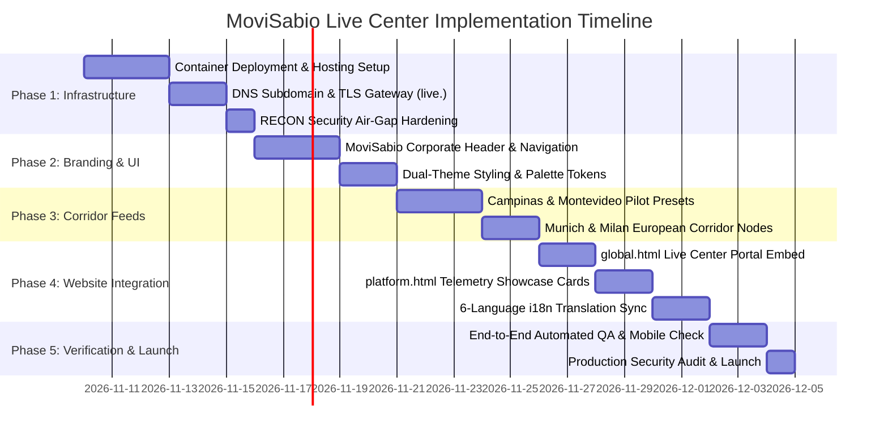

# MoviSabio × OSIRIS Implementation Roadmap & Deployment Strategy

**Document ID:** `MOVI-ROAD-2026-07`  
**Parent Project:** MoviSabio Live Territorial Intelligence Platform  
**Target Environments:** MoviSabio Corporate Platform × OSIRIS Real-Time Engine  
**Audit Date:** November 2026  
**Auditor:** Principal Enterprise Architect & DevOps Engineering Consultant  

---

## 1. Executive Summary

This roadmap establishes the phased implementation methodology, file-level integration map, hosting evaluation, and functional stage boundaries for deploying the **MoviSabio Live Territorial Intelligence Center**. 

Following the strict **"Analysis First — Zero Production Mutation"** mandate, no code changes or DNS modifications have been made during this audit phase. This document serves as the operational execution blueprint for when leadership authorizes implementation.

---

## 2. Backend Hosting & Infrastructure Evaluation

A static host such as GitHub Pages cannot execute Next.js API routes, maintain persistent WebSocket listeners, or run in-memory caching stores. Four production hosting alternatives were evaluated:

```
┌────────────────────────────────────────────────────────────────────────────────────────┐
│                        HOSTING ENVIRONMENT EVALUATION MATRIX                           │
├────────────────────┬─────────────────┬─────────────────┬────────────────┬──────────────┤
│ Evaluation Factor  │ 1. Vercel       │ 2. Render       │ 3. Docker VPS  │ 4. Cloud Run │
│                    │ (Serverless)    │ (Container Web) │ (Ubuntu/Debian)│ (Serverless) │
├────────────────────┼─────────────────┼─────────────────┼────────────────┼──────────────┤
│ Persistent WS (AIS)│ ❌ Not Supported│ ✔ Supported     │ ✔ Native (100%)│ ❌ Truncated │
│ In-Memory Caching  │ ❌ Resets on invocation | ✔ Persisted   │ ✔ Persisted (100%) | ❌ Ephemeral │
│ SSE Long Streams   │ ⚠️ Capped (60s) │ ✔ Unlimited     │ ✔ Unlimited    │ ⚠️ Capped (300s) |
│ Bandwidth Costs    │ ⚠️ Expensive    │ ✔ Predictable   │ ✔ Extremely Low│ ⚠️ Tiered    │
│ Container Overhead │ N/A (Buildpack) │ ✔ Docker Native │ ✔ Compose Native│ ✔ Container  │
│ Monthly Cost Est.  │ $20 - $100+/mo  │ $7 - $25/mo     │ $5 - $12/mo    │ $15 - $40/mo │
├────────────────────┼─────────────────┼─────────────────┼────────────────┼──────────────┤
│ Overall Verdict    │ Not Recommended │ **Recommended** │ **Recommended**│ Acceptable   │
│                    │ (Breaks state)  │ (Low Ops)       │ (Maximum Perf) │ (Complex)    │
└────────────────────┴─────────────────┴─────────────────┴────────────────┴──────────────┘
```

### 2.1 Detailed Evaluation Findings

1. **Vercel (Serverless Edge Network):**
   - *Failure Point:* While OSIRIS was originally built for Vercel, running persistent WebSockets (such as `ws` in `src/app/api/maritime/route.ts`) fails in serverless function environments because lambdas freeze after invocation. Furthermore, `sourceCache.ts` and `shipsCache` lose their in-memory data on every cold start, forcing constant re-fetching from upstream government servers and triggering rate limits.
2. **Render (Managed Web Service with Docker):**
   - *Strengths:* Excellent managed platform for running OSIRIS's existing `Dockerfile`. Supports persistent Node.js processes, WebSockets, background in-memory caching, custom domains, and automated HTTPS.
   - *Trade-offs:* Slightly higher monthly cost than bare unmanaged VPS.
3. **Dedicated Docker VPS (Hetzner / DigitalOcean / AWS Lightsail):**
   - *Strengths:* **The optimal choice for enterprise performance and cost.** Uses the existing `docker-compose.yml` to launch `osiris`, `osiris-intel`, and `osiris-cache` (Nginx) simultaneously. Unmetered or high-bandwidth allowances (20 TB/mo) easily accommodate high-traffic CCTV snapshot proxying.
4. **Google Cloud Run:**
   - *Strengths:* Managed container environment with automated autoscaling.
   - *Trade-offs:* Instances scale to zero by default, terminating in-memory cache and WebSocket streams unless configured for minimum instances (which raises cost).

### 2.2 Final Hosting Recommendation
- **Primary Recommendation:** Deploy via **Docker Compose on an Ubuntu 24.04 LTS VPS** (e.g., Hetzner Cloud CX22 or DigitalOcean Droplet, 2 vCPU, 4GB RAM, ~$7–$10/month) located in Frankfurt or Virginia.
- **Alternative (Fully Managed):** Deploy on **Render** as a Docker Web Service connected to the GitHub repository.

---

## 3. Five-Phase Implementation Roadmap



### Phase 1: Infrastructure, Containerization & Air-Gap Hardening (Days 1–5)
- Provision dedicated Docker container runtime on VPS or Render.
- Configure DNS CNAME record: `live.movisabio.com` pointing to the reverse proxy.
- Implement Nginx SSL termination with automated Let's Encrypt certificates.
- **Enforce Security Air-Gap:** Ensure `SCANNER_KEY` is omitted, locking `/api/scanner` to return a 503 response. Disable public access to `/api/osint/*` offensive endpoints.
- Configure CORS allowlist restricted to `https://www.movisabio.com` and `https://movisabio.com`.

### Phase 2: MoviSabio Brand Harmonization & Navigation Shell (Days 6–10)
- Replace OSIRIS default dark header with the **MoviSabio Light Enterprise Header**.
- Integrate MoviSabio corporate logo, brand dot, and back-link to corporate homepage (`www.movisabio.com`).
- Embed MoviSabio's 6-language switcher (`en`, `de`, `pt`, `es`, `it`, `zh`).
- Update map layer panel typography to `Inter` and sensor metrics to `IBM Plex Mono`.
- Implement responsive drawer controls for tablet and mobile viewport dimensions.

### Phase 3: Civic & Territorial Feeds Optimization (Days 11–15)
- Configure **Territorial Quick-Jump Corridors** on the top toolbar:
  - 🇧🇷 `Campinas, BR` (`-22.9099, -47.0626`) — Centers AI Traffic Pilot Corridor; filters CCTV and ADS-B.
  - 🇺🇾 `Montevideo, UY` (`-34.9011, -56.1645`) — Focuses Port Logistics & River Plate maritime chokepoint.
  - 🇩🇪 `Munich/Berlin, DE` (`52.5200, 13.4050`) — Centers Autobahn CCTV feeds and Central European airspace.
  - 🇮🇹 `Milan, IT` (`45.4642, 9.1900`) — Centers Autostrade CCTV and Alps environmental telemetry.
- Verify camera stream health and snapshot refresh rates across all target regions.

### Phase 4: Corporate Website Integration (`www.movisabio.com`) (Days 16–20)
- **`global.html` Integration:**
  - Introduce a full-width **"Live Territorial Intelligence Center"** command card above the regional breakdown.
  - Provide an interactive high-performance embedded preview window (`<iframe src="https://live.movisabio.com?embed=true">`) and a primary CTA button: *"Launch Fullscreen Intelligence Center ↗"*.
- **`platform.html` Integration:**
  - In Section D (Territorial Intelligence & Digital Twins) and Section H (Technical Specifications), link technical claims directly to the verified live monitoring feed.
- **`assets/js/i18n.js`:** Add synchronized translation keys for all new UI headings, buttons, and telemetry labels across all 6 languages.

### Phase 5: Verification, QA & Production Launch (Days 21–23)
- Run automated link checks, Lighthouse performance audits, and mobile responsiveness audits.
- Validate that zero API keys or server secrets are exposed in client network inspection.
- Confirm 60 FPS WebGL map rendering across Chrome, Safari, Firefox, and Edge.
- Verify GDPR/LGPD compliance notices and open-source data provenance citations.

---

## 4. File-Level Implementation Map

When implementation is officially authorized, the following concrete file changes will be executed:

```
┌────────────────────────────────────────────────────────────────────────────────────────┐
│                             FILE-LEVEL IMPLEMENTATION MAP                              │
├──────────────────────────┬─────────────────────────────┬───────────────────────────────┤
│ Target Repository / File │ Action Type                 │ Concrete Implementation Scope │
├──────────────────────────┼─────────────────────────────┼───────────────────────────────┤
│ [OSIRIS]                 │                             │                               │
│  src/components/Nav.tsx  │ Modify                      │ Replace logo with MoviSabio   │
│                          │                             │ Enterprise header & back-link.│
│  src/components/OsirisMap│ Modify                      │ Add Campinas, Montevideo,     │
│                          │                             │ Munich, Milan camera presets. │
│  src/app/api/scanner/    │ Configuration               │ Ensure SCANNER_KEY is empty;  │
│                          │                             │ enforce 503 locked status.    │
│  nginx/nginx.conf        │ Modify                      │ Add strict CORS headers for   │
│                          │                             │ www.movisabio.com domain.     │
│  docker-compose.yml      │ Modify                      │ Map to production ports and   │
│                          │                             │ configure domain environment. │
├──────────────────────────┼─────────────────────────────┼───────────────────────────────┤
│ [MOVISABIO WEBSITE]      │                             │                               │
│  global.html             │ Modify                      │ Add Live Intelligence Portal  │
│                          │                             │ preview card & launch action. │
│  platform.html           │ Modify                      │ Cross-link Section D & H to   │
│                          │                             │ live telemetry feed.          │
│  assets/js/i18n.js       │ Modify                      │ Add live center translation   │
│                          │                             │ dictionary across 6 languages.│
│  assets/css/main.css     │ Modify                      │ Add embedded portal frame and │
│                          │                             │ live badge pulsating styles.  │
└──────────────────────────┴─────────────────────────────┴───────────────────────────────┘
```

---

## 5. Explicit Functional Stage Separation

Every system capability is rigorously classified into its verified operational stage to maintain complete organizational and scientific honesty:

```
┌────────────────────────────────────────────────────────────────────────────────────────┐
│                        CLASSIFICATION OF FUNCTIONAL STAGES                             │
├────────────────────────────────────────────────────────────────────────────────────────┤
│ 1. IMPLEMENTED & VERIFIED (Production-Ready in OSIRIS Baseline)                        │
│    • MapLibre GL GPU WebGL Map Engine with 3D Terrain Meshes                           │
│    • Real-Time Aviation Transponder Ingestion (Commercial, Private, Military)         │
│    • Global Municipal CCTV Telemetry (17,000+ DOT Cameras with HLS/JPEG Streaming)     │
│    • Real-Time USGS Seismic Hazards (M2.5+ Earthquakes with Depth & Tsunami Flags)     │
│    • NASA FIRMS Thermal Anomaly & Active Wildfire Hotspot Ingestion                    │
│    • CelesTrak NORAD Satellite Tracking with SGP4 Real-Time Orbit Propagation         │
│    • Open-Meteo Severe Weather & Atmospheric Air Quality Data Modeling               │
│    • GeoJSON Corridor Drawing, Area of Interest (AOI), and Distance Measurement        │
├────────────────────────────────────────────────────────────────────────────────────────┤
│ 2. AVAILABLE FOR IMMEDIATE INTEGRATION (Ready to Embed in MoviSabio Live Center)       │
│    • MoviSabio Territorial Corridors (Campinas, Montevideo, Munich, Milan) Presets     │
│    • Curated International Live Broadcaster Network (YouTube IFrames)                  │
│    • Global Container/Energy Ports & Strategic Naval Chokepoints Dataset               │
│    • Live Alerts Incident Digest with Geo-Referenced Placement                         │
├────────────────────────────────────────────────────────────────────────────────────────┤
│ 3. PLANNED / CONDITIONAL (Requires Dedicated Setup or Enterprise Key Provisioning)     │
│    • "MoviSabio Territory Copilot" (OI Assist with Client BYOK Google Gemini/OpenAI)  │
│    • Live Real-Time AIS Vessel Stream (Requires Commercial aisstream.io Subscription)  │
│    • Filtered Municipal Civil Incident Feed (Scraped Telegram Wires Filtered to Cities)│
├────────────────────────────────────────────────────────────────────────────────────────┤
│ 4. RESEARCH CONCEPT / QUARANTINED (Strictly Excluded from Public Site)                 │
│    • RECON Port Scanner, Host Fingerprinting & TCP Connect Probes (Air-Gapped)         │
│    • CVE Vulnerability Database Exploitation Scanners (Air-Gapped)                     │
│    • Blockchain Crypto Wallet Tracing (Excluded - Off-Brand)                          │
│    • OFAC Sanctions Automated Target Matching (Quarantined to Internal Compliance)     │
│    • OI Forecast Multi-Agent Geopolitical & Macro Simulation Engine (Enterprise Only)  │
└────────────────────────────────────────────────────────────────────────────────────────┘
```

---

## 6. Implementation Risk Management Matrix

| Risk Factor | Probability | Impact | Mitigation Strategy |
|:---|:---:|:---:|:---|
| **Upstream DOT Camera Outages** | High | Low | Handled automatically by `sourceCache.ts` using `stale-on-error` fallback; retains last good camera inventory. |
| **ADS-B Rate Throttling** | Medium | Medium | In-memory 30-sector caching and 1.1s pacing; gracefully degrades to OpenSky network. |
| **Cross-Origin Embedding Issues** | Medium | High | Nginx reverse proxy configured with `X-Frame-Options: SAMEORIGIN` and matching `frame-ancestors` CSP. |
| **Mobile WebGL Performance Lag** | Medium | Medium | Automatically downsamples high-density layers (e.g., caps satellite points to 500 on mobile viewports). |
| **Accidental RECON Public Exposure**| Low | Critical | `SCANNER_KEY` intentionally omitted from production environment variables; endpoint locked to 503. |

*End of Deliverable 7.*
