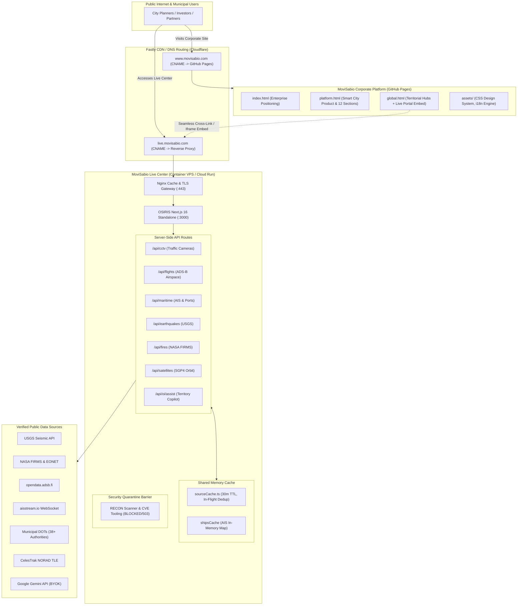

# Proposed Integration Architecture: MoviSabio Live Territorial Intelligence Center

**Document ID:** `MOVI-ARCH-2026-04`  
**Parent Project:** MoviSabio Enterprise Platform × OSIRIS Real-Time Telemetry Engine  
**Audit Date:** November 2026  
**Auditor:** Principal Enterprise Software Architect & Cloud Infrastructure Consultant  

---

## 1. Executive Summary

This architecture specification outlines the strategy for integrating the OSIRIS real-time telemetry engine into the MoviSabio web ecosystem. The objective is to establish:

> **"MoviSabio Intelligence — Live Territorial Intelligence & Global Monitoring"**

The architecture must satisfy four primary constraints:
1. **Preserve Corporate Website Stability:** The existing static MoviSabio corporate site (`www.movisabio.com`) on GitHub Pages must remain fast, secure, and completely insulated from backend failures or heavy compute spikes.
2. **Support Real-Time Telemetry:** Deliver 60 FPS GPU-accelerated MapLibre visualization for tens of thousands of dynamic vector entities (CCTV, flights, ships, quakes, fires, weather, satellites).
3. **Strict Security Isolation:** Enforce a hard quarantine around RECON port scanning, host fingerprinting, and offensive cyber tools, preventing any public exposure from MoviSabio domains.
4. **Honest Data Provenance:** Avoid simulated or fake live metrics; provide transparent data-source attribution, real-time timestamps, and direct operator links.

---

## 2. Evaluation of Integration Architectural Patterns

Three primary architectural patterns were rigorously evaluated:

```
┌────────────────────────────────────────────────────────────────────────┐
│                   ARCHITECTURAL PATTERN COMPARISON                     │
├────────────────────┬────────────────────┬──────────────────────────────┤
│ OPTION A           │ OPTION B           │ OPTION C                     │
│ Dedicated Branded  │ Headless API       │ Shared Component             │
│ Subdomain App      │ Gateway + Custom   │ Package                      │
│ (Recommended)      │ Static Client      │ (Monorepo)                   │
├────────────────────┼────────────────────┼──────────────────────────────┤
│ live.movisabio.com │ www.movisabio.com  │ Monorepo with                │
│ standalone Docker  │ calls remote API   │ shared npm packages          │
│ container instance │ gateway via CORS   │ across codebases             │
├────────────────────┼────────────────────┼──────────────────────────────┤
│ • Zero code churn  │ • Heavy rewrite of │ • Complete rebuild of        │
│   on corporate site│   MapLibre in pure │   MoviSabio static site into │
│ • 100% OSIRIS      │   vanilla JS       │   Next.js / Vite app         │
│   feature fidelity │ • CORS maintenance │ • High coupling risk         │
│ • Independent CI/CD│ • Risk of API skew │ • Fragile build pipeline     │
└────────────────────┴────────────────────┴──────────────────────────────┘
```

### 2.1 Option A: Dedicated Branded Subdomain Engine (`live.movisabio.com`)
- **Description:** Deploy the OSIRIS Next.js 16 container as a dedicated service mapped to a custom subdomain (e.g., `https://live.movisabio.com` or `https://intelligence.movisabio.com`). The application is branded with MoviSabio corporate identity (Light Enterprise headers, brand mark, navigation back to main site) while maintaining its native WebGL map workspace. The corporate site links to this live center via primary navigation and embeds interactive preview widgets.
- **Advantages:**
  - **Zero Regression Risk:** The existing corporate website remains completely untouched on GitHub Pages.
  - **Full Runtime Capability:** Seamlessly executes Next.js server-side API routes, in-memory caching (`sourceCache.ts`), HLS video proxying, and WebSocket listeners.
  - **Independent Deployment & Scaling:** Telemetry spikes, stream decoding, or memory loads never affect the availability of corporate marketing or pitch pages.
  - **Lowest Total Cost of Implementation:** Reuses 100% of OSIRIS's existing, verified components.
- **Disadvantages:**
  - Requires configuring a DNS CNAME record and managing an external container instance.

### 2.2 Option B: Headless API Gateway + Custom Vanilla JS Map
- **Description:** Deploy OSIRIS strictly as a headless JSON API gateway. Rewrite MoviSabio's `global.html` to consume `/api/cctv`, `/api/flights`, `/api/earthquakes`, etc., directly via client-side fetch calls, attempting to render them on Leaflet or a vanilla MapLibre JS instance embedded inside `global.html`.
- **Advantages:**
  - All content resides on a single domain (`www.movisabio.com`).
- **Disadvantages:**
  - **Severe Engineering Overhead:** Requires rewriting thousands of lines of React state management, LayerPanel drawer components, HLS video players, and SGP4 orbit workers in vanilla JavaScript.
  - **Leaflet Performance Ceiling:** Leaflet cannot comfortably handle thousands of moving vector entities without dropping frames.
  - **CORS & Proxy Vulnerability:** Exposes backend API endpoints to cross-origin abuse and rate-limit exhaustion.

### 2.3 Option C: Shared Monorepo / Component Package (`@movisabio/map-core`)
- **Description:** Convert both repositories into a monorepo (e.g., Turborepo or npm workspaces) and extract the MapLibre components into a shared package (`@movisabio/map-core`) consumed by both the website and OSIRIS.
- **Advantages:**
  - Maximum code reuse across enterprise software products.
- **Disadvantages:**
  - **Unnecessary Architectural Churn:** Forces MoviSabio's ultra-fast, zero-build static corporate site into a complex Node.js build system, destroying its current simplicity and reliability.
  - **High Maintenance Overhead:** Version mismatches and shared dependency conflicts.

---

## 3. Recommended Architecture: The Hybrid Subdomain Portal (Option A+)

The definitive recommendation is **Option A+ (Hybrid Subdomain Portal)**. This model provides the optimal balance of enterprise stability, GPU performance, and cohesive brand experience.



---

## 4. Branding & UI Design: "MoviSabio Intelligence"

The interface must bridge MoviSabio's clean corporate identity with high-intensity command-center ergonomics:

### 4.1 Master Design System Tokens
- **Canvas Environment:**
  - Navigation & Enclosing Shell: `var(--bg-primary)` (`#F5F8FC` Light Canvas) or `#0B132B` (Dual Mode).
  - Tactical Map Workspace: `#080C14` (Deep Space Dark Matter).
  - Floating Telemetry Cards: `#101A26` with `rgba(255, 255, 255, 0.08)` borders and subtle backdrop-blur (`12px`).
- **Brand Typography:**
  - Headers & Identity: `Inter`, `system-ui`, `-apple-system`, `sans-serif`.
  - Telemetry & Sensor Metrics: `IBM Plex Mono` / `SF Mono` for timestamps, ICAO codes, coordinates, and altitudes.
- **Accent Signals & Status Indicators:**
  - MoviSabio Primary Cyan: `#087EA4` (Corporate) / `#00E5FF` (Radar Arc & Highlight Pin).
  - Enterprise Action Blue: `#2563EB` (Primary CTA & Corridor Bounds).
  - Live Telemetry Green: `#10B981` (Live Signal Status Indicator, pulsating 2s cycle).
  - Hazard Alert Amber: `#F59E0B` (Seismic & Weather Warning).
  - Thermal Anomaly Orange: `#EF4444` (Active Wildfire FRP).

### 4.2 Top Bar & Navigation Header
```
┌────────────────────────────────────────────────────────────────────────────────────────────────────────────────────────┐
│ [●] MOVISABIO INTELLIGENCE  |  Live Territorial Intelligence Center        [CAMPINAS] [MONTEVIDEO] [MUNICH] [MILAN]    │
│ Status: [● LIVE] 60 FPS | Feeds: 17,420 CCTV • 3,840 Aircraft • 42 Quakes  | Lang: [EN ▾]  [⤢ Fullscreen] [← Back Site]│
└────────────────────────────────────────────────────────────────────────────────────────────────────────────────────────┘
```
- **Brand Dot:** Pulsing green radar dot indicating continuous ingestion.
- **Territory Jump Buttons:** Quick-zoom pill buttons that instantly fly the camera directly to MoviSabio's active pilot corridors (Campinas, Brazil; Montevideo, Uruguay; Munich/Berlin, Germany; Milan, Italy).
- **Return Anchor:** Seamless navigation back to `https://www.movisabio.com/`.

### 4.3 Layer Control Drawer (Collapsible Right Rail)
- Categorized accordion controls for:
  - **Civic Infrastructure:** Public Traffic Cameras (with preview grid), Airport Airspaces, Port Corridors.
  - **Environmental & Climate:** Active Wildfires (NASA), Seismic Monitoring (USGS), $PM_{2.5}$ Air Quality.
  - **Orbital & Space-Time:** Earth Observation Satellites (Sentinel, Landsat), Day/Night Terminator.
  - **Territory Tools:** AOI Corridor Drawing, Distance Measurement, GeoJSON Export.

---

## 5. Security & Reverse Proxy Architecture

### 5.1 Nginx Reverse Proxy Configuration (`nginx/nginx.conf`)
The Nginx container handles SSL termination, response caching, compression, and header sanitation:

```nginx
# Security Headers & CORS Enforcement
add_header X-Frame-Options "SAMEORIGIN" always;
add_header X-Content-Type-Options "nosniff" always;
add_header X-XSS-Protection "1; mode=block" always;
add_header Referrer-Policy "strict-origin-when-cross-origin" always;
add_header Content-Security-Policy "default-src 'self' https: data: blob: 'unsafe-inline' 'unsafe-eval'; connect-src 'self' https: wss:; worker-src 'self' blob:;" always;

# CORS allowlist for MoviSabio Corporate Domains
map $http_origin $cors_origin {
    default "";
    "~^https?://(www\.)?movisabio\.com$" "$http_origin";
    "~^https?://localhost(:[0-9]+)?$" "$http_origin";
}

location /api/ {
    if ($cors_origin != "") {
        add_header 'Access-Control-Allow-Origin' '$cors_origin' always;
        add_header 'Access-Control-Allow-Methods' 'GET, POST, OPTIONS' always;
        add_header 'Access-Control-Allow-Headers' 'DNT,User-Agent,X-Requested-With,If-Modified-Since,Cache-Control,Content-Type,Range,X-OI-Key,X-OI-Provider,X-OI-Model' always;
    }

    if ($request_method = 'OPTIONS') {
        return 204;
    }

    proxy_pass http://osiris:3000;
    proxy_set_header Host $host;
    proxy_set_header X-Real-IP $remote_addr;
    proxy_set_header X-Forwarded-For $proxy_add_x_forwarded_for;
    proxy_set_header X-Forwarded-Proto $scheme;

    # SSE Streaming Support
    proxy_buffering off;
    proxy_cache off;
    proxy_read_timeout 300s;
}
```

### 5.2 Server-Sent Events (SSE) & WebSocket Handling
- Routes such as `/api/oi/runs/[id]/events` stream live model updates using `text/event-stream`.
- Nginx disables proxy buffering (`proxy_buffering off`) and extends read timeouts (`proxy_read_timeout 300s`) to prevent connection dropouts.
- Duplex WebSocket connections for live AIS maritime vessel streams (`/api/maritime`) are proxied with `Upgrade` and `Connection: "upgrade"` HTTP headers.

---

## 6. Data Provenance & Anti-Simulation Standard

To protect MoviSabio's institutional credibility with municipalities and international investors:
1. **Zero Simulated Entities in Live Layers:** No randomly generated or fake aircraft, cameras, or sensor values may be presented as live data. If an upstream government API times out and the cache expires, the UI displays a clean status message: `[Upstream Offline - Reconnecting...]` rather than synthetic data.
2. **Transparent Provenance Badges:** Every telemetry card surfaces its verifiable origin (e.g., `Source: USGS Earthquake Hazards Program`, `Provider: WSDOT Traffic API`, `Telemetry: opendata.adsb.fi`).
3. **Timestamp Validation:** All metrics display human-readable age indicators (`Updated 12s ago`, `Acquired 2026-11-07 03:45 UTC`).

*End of Deliverable 4.*
